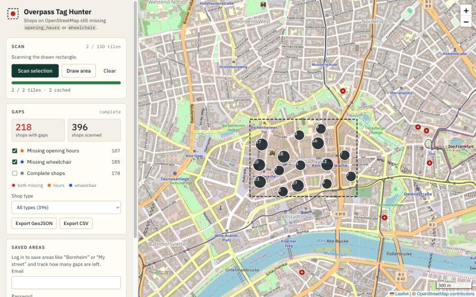

# Overpass Tag Hunter

A web map that shows OpenStreetMap mappers which shops in an area are still missing
`opening_hours` or `wheelchair` tags, so they know exactly where to go and what to survey.

An Express.js backend splits big areas into fixed map tiles, queues the Overpass API queries
politely (one at a time, with backoff) and caches the GeoJSON per tile in SQLite. A Leaflet map
shows the gaps as colour-coded markers with one-click links into the iD editor.

**Stack:** TypeScript, Node.js, Express.js, Leaflet (+ Vite, SQLite via better-sqlite3).



## How it works

1. Pan the map to your district (or **Draw area** for a rectangle) and press **Scan**.
2. The server plans the zoom-14 tiles that cover the area. Tiles cached in the last 24 h are answered
   at once; the rest go into a one-at-a-time Overpass queue.
3. A progress bar fills over Server-Sent Events, finished tiles turn green on the map (failed ones red),
   and markers appear: **red** = both tags missing, **orange** = `opening_hours` missing,
   **blue** = `wheelchair` missing.
4. Click a marker for its name and tags plus **Edit in iD** / **View on OSM** buttons.
5. With a free account, save areas ("Bornheim", "My street"), rescan them later and watch the
   "gaps left" trend (`34 → 21 since 1 Nov`) and a small history chart.

```
browser bbox ─► POST /api/scans ─► tile planner (z14) ─┬─► cache hits (≤24 h) ─────────────┐
                                                        └─► Overpass queue (concurrency 1) ─┤
                                                             backoff 5/15/45 s, split on     │
                                                             timeout, GeoJSON per tile       ▼
              Leaflet ◄── GET /api/scans/:id/result ◄── merge + dedup by type/id ◄── tile_cache
                     ◄── GET /api/scans/:id/events (SSE: progress … complete)
```

## Quick start

Requires Node.js 20+ (22 LTS recommended).

```bash
npm install
cp .env.example .env        # then set JWT_SECRET
npm run dev                 # API on :3000 (tsx watch), web on :5173 (Vite proxies /api)
```

Open http://localhost:5173.

Other scripts:

| Command             | What it does                                         |
| ------------------- | ---------------------------------------------------- |
| `npm test`          | Server tests (Vitest + Supertest) and web unit tests |
| `npm run typecheck` | Type-check both workspaces                           |
| `npm run build`     | Build `web/dist` and `server/dist`                   |
| `npm start`         | Run the built server; it also serves `web/dist`      |

### Docker

```bash
docker build -t tag-hunter .
docker run -p 3000:3000 -v "$(pwd)/data:/app/data" -e JWT_SECRET=change-me tag-hunter
```

The SQLite file lives in the mounted `data/` folder, so users, saved areas and the tile cache
survive container restarts.

### Configuration (`.env`)

| Variable                 | Default                                   | Notes                                                         |
| ------------------------ | ----------------------------------------- | ------------------------------------------------------------- |
| `JWT_SECRET`             | random per start (dev only)               | **Required** in production                                    |
| `OVERPASS_URL`           | `https://overpass-api.de/api/interpreter` | Main instance                                                 |
| `OVERPASS_FALLBACK_URLS` | _(none)_                                  | Comma-separated; used after a 429/502/503 from the main one   |
| `OVERPASS_CHECK_STATUS`  | `true`                                    | Ask `/api/status` for a free slot before each query           |
| `USER_AGENT`             | `OverpassTagHunter/0.1 (…)`               | Put your repo URL here so the Overpass operators can reach you |
| `API_PORT` / `PORT`      | `3000`                                    | API port (`API_PORT` wins)                                    |
| `DB_PATH`                | `<repo>/data/tag-hunter.db`               | SQLite file                                                   |
| `MAX_TILES`              | `150`                                     | Largest scan, in zoom-14 tiles                                |

## Respecting the Overpass usage limits

The public Overpass instance is a shared, volunteer-run resource (roughly < 10,000 queries and
< 1 GB per day per user, and a few concurrent slots per client). The app is built to stay well
inside that:

- **One query at a time.** All scans from all users share one `p-queue` with `concurrency: 1`.
- **Small, fixed queries.** Each zoom-14 tile (~1.6 × 1.6 km in Frankfurt) is one
  `nwr["shop"](bbox); out center tags;` query. Scans over 150 tiles are rejected up front.
- **Slot check.** Before each query the server reads `/api/status` and waits if no slot is free.
- **Backoff.** 429, 502, 503 and 504 are retried after 5 s, 15 s and 45 s; after that the tile is
  marked `failed` and the scan continues. If a fallback instance is configured, busy answers
  rotate to it.
- **Split on timeout.** A tile that still times out (dense city centres) is split into its four
  zoom-15 children and re-queued once.
- **Shared 24-hour cache.** Results are stored per `z/x/y` tile, so overlapping scans by different
  users reuse each other's work. Rescanning an area within 24 h costs zero Overpass queries. A
  saved area can force a refresh at most once per hour.
- **Identifiable client.** Every request carries a descriptive `User-Agent`.

Map tiles come from `tile.openstreetmap.org` with attribution, which the OSM tile usage policy
allows for light use like this; heavy use needs another tile provider.

## API

| Method and path                | Auth     | Does                                                                     |
| ------------------------------ | -------- | ------------------------------------------------------------------------ |
| `POST /api/scans`              | –        | `{south, west, north, east}` → `{jobId, tiles, cached, grid}` (202)      |
| `GET /api/scans/:id/events`    | –        | SSE: `snapshot`, `progress {done,total,failed,cached,tile}`, `complete`  |
| `GET /api/scans/:id/result`    | –        | Merged GeoJSON with `missingHours` / `missingWheelchair` + `counts`      |
| `POST /api/auth/register`      | –        | Email + password (min 10 chars) → JWT (bcrypt hash stored)               |
| `POST /api/auth/login`         | –        | → JWT (7-day expiry)                                                     |
| `GET /api/auth/me`             | JWT      | Current user                                                             |
| `GET /api/areas`               | JWT      | Saved areas with latest/previous counts and history                     |
| `POST /api/areas`              | JWT      | Save `{name, south, west, north, east, jobId?}`                          |
| `DELETE /api/areas/:id`        | JWT      | Delete (403 for another user's area)                                     |
| `POST /api/areas/:id/scan`     | JWT      | Rescan `{force?}`; appends a row to `area_scans` when done               |
| `POST /api/areas/:id/share`    | JWT      | Create a read-only share token (`/?share=<token>`)                       |
| `GET /api/shared/:token`       | –        | Public read-only view of a shared area                                   |

Auth routes are rate-limited (`express-rate-limit`), every body is validated with `zod`, and tokens
are sent as `Authorization: Bearer <token>`.

## Project layout

```
overpass-tag-hunter/
├── package.json          # npm workspaces: server, web
├── Dockerfile            # builds web, then runs server
├── .env.example
├── server/
│   ├── src/
│   │   ├── index.ts      # starts the HTTP server
│   │   ├── app.ts        # Express app, routes, static files
│   │   ├── config.ts     # env config
│   │   ├── tiles.ts      # bbox <-> z/x/y maths
│   │   ├── overpass.ts   # query builder, classification, fetch + backoff
│   │   ├── queue.ts      # one-at-a-time worker, tile splitting
│   │   ├── cache.ts      # tile_cache read/write
│   │   ├── scans.ts      # jobs, SSE, merge + dedup
│   │   ├── auth.ts       # register, login, requireAuth
│   │   ├── areas.ts      # saved areas, rescans, share links
│   │   ├── validation.ts # zod schemas
│   │   └── db.ts         # better-sqlite3 + schema
│   └── test/             # vitest + supertest
└── web/
    ├── index.html
    └── src/{main,map,scan,auth,api,export,tiles}.ts, styles.css
```

## Tests

`npm test` covers the guide's testing checklist:

- tile maths for a bbox around Frankfurt city centre, and back again;
- a mocked 504 triggers backoff (5 s, 15 s, 45 s), then a split into 4 child tiles;
- scanning the same area twice within 24 hours makes zero Overpass calls the second time;
- a way crossing a tile edge appears once in the result;
- a scan over 150 tiles is rejected with a clear message;
- protected routes return 401 without a token and 403 for another user's area;
- editor links point at the right node / way / relation on openstreetmap.org;

plus 502/503 retries, fallback rotation, SSE streaming, forced-refresh limits, share links and CSV export.

## Features

MVP: area scans up to 150 zoom-14 tiles · tiling, one-at-a-time queue, backoff and tile splitting ·
24-hour tile cache with dedup across tile edges · colour-coded markers, filters, shop-type dropdown
and editor links · JWT accounts with saved areas · live progress via Server-Sent Events ·
GeoJSON / CSV export for field surveys.

Stretch goals built: per-area progress history chart · fallback Overpass instance · shareable
read-only link for a saved area · `missingWebsite` flag on every feature (included in the GeoJSON export).

## License

Code: MIT. Map data © OpenStreetMap contributors, available under the
[Open Database License](https://www.openstreetmap.org/copyright).
